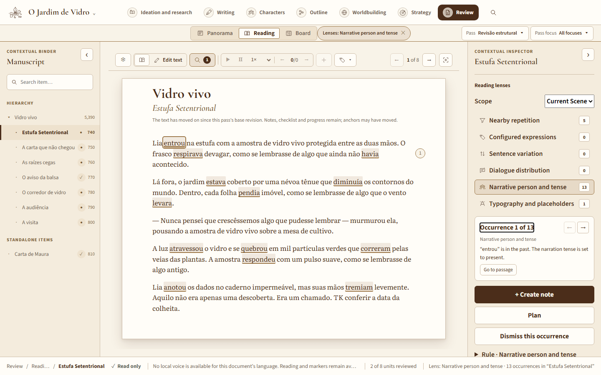
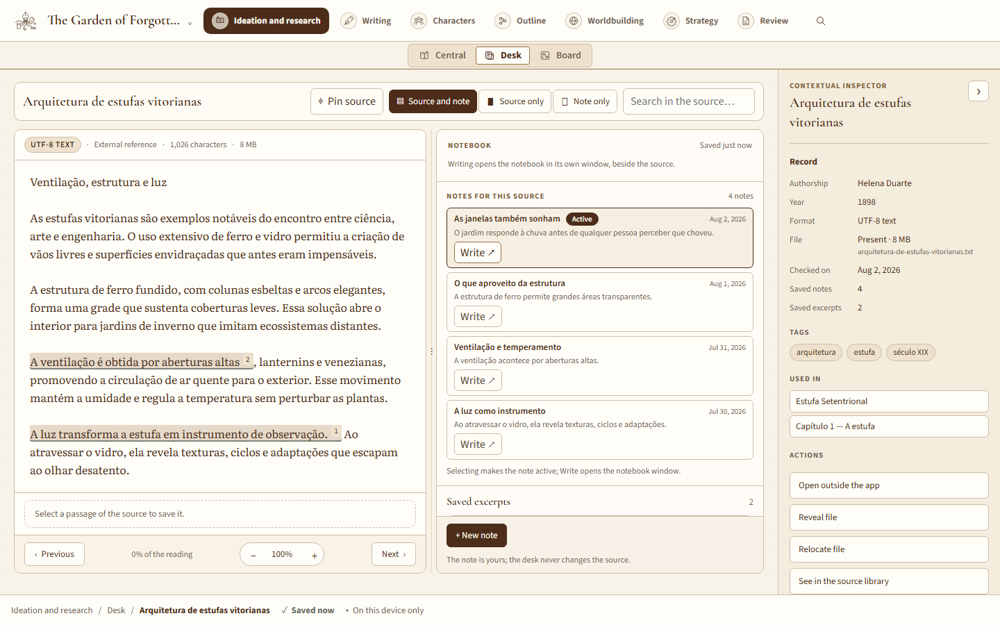
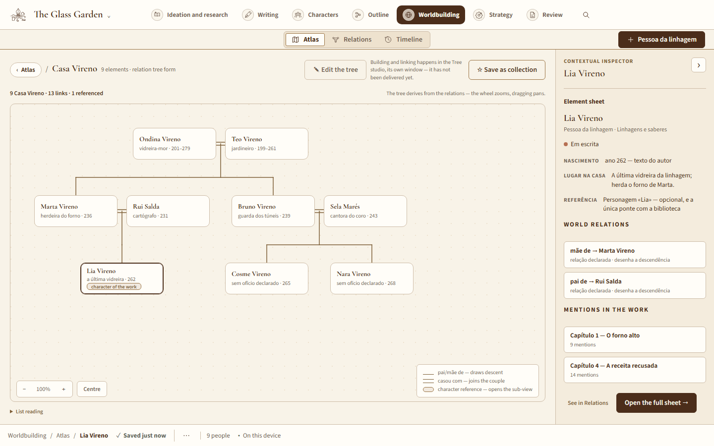
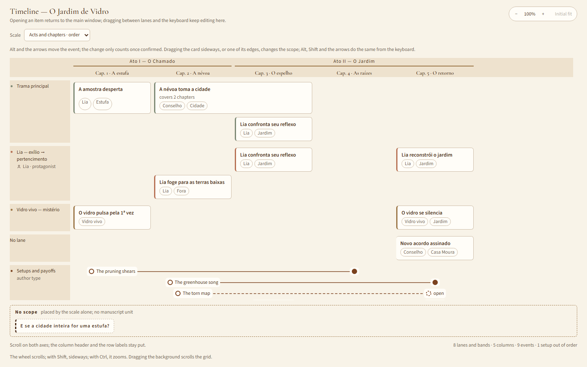
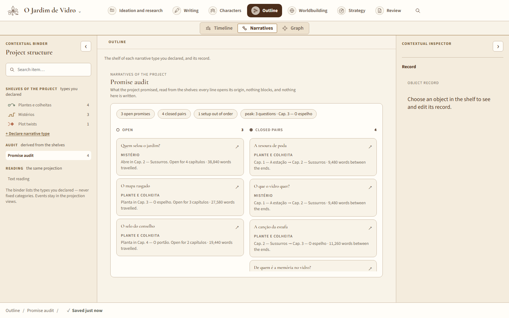
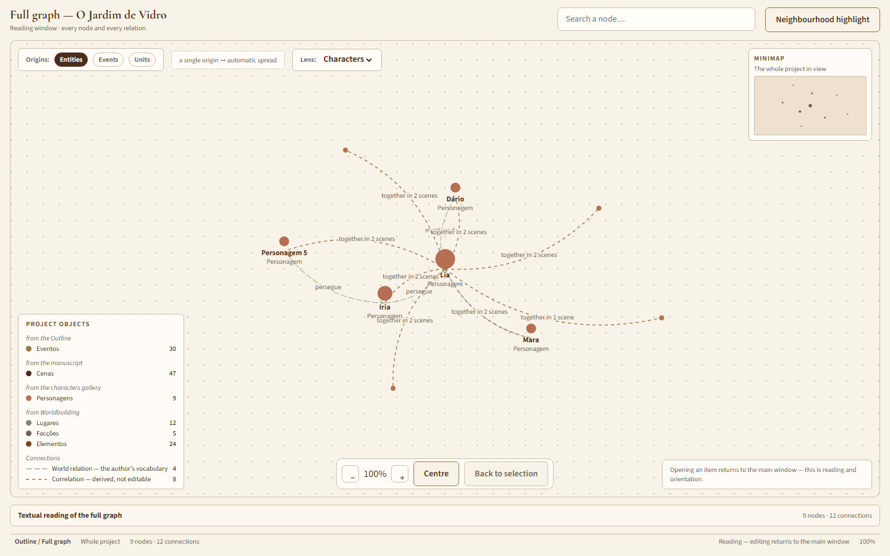
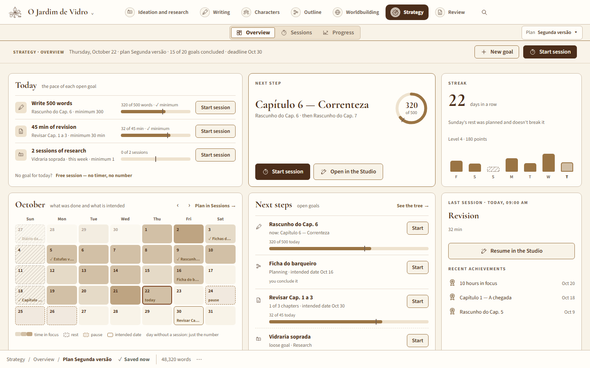
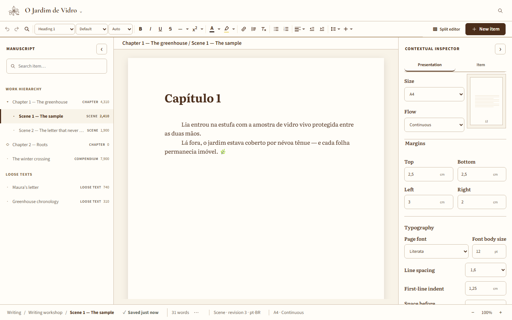
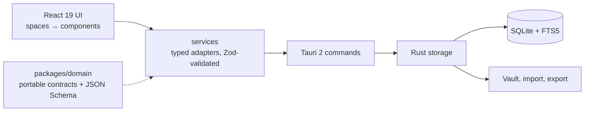

# Case study

**English** · [Português](README.pt-BR.md)

A local-first desktop writing platform for long-form authors: research,
worldbuilding, outlining, drafting and revision in one app, without imposing
a narrative method.

> The source code is private. This repository documents the product, the
> architecture, the key decisions and how the work is tested.

## The problem

Writers of novels and long non-fiction spread their work across many tools —
one for notes, one for the outline, one for the world, one for the
manuscript. Most of them either live in the cloud or impose a structure:
chapters, scenes, a fixed character sheet, a "correct" story theory.

The platform takes the opposite position:

- **local-first** — the author's computer is the source of truth; no account,
  no server, works offline;
- **configurable, not prescriptive** — item types, fields, views, vocabulary
  and narrative capabilities are declared by the author; there is no built-in
  "chapter" or "arc";
- **the manuscript is sacred** — every write is transactional, versioned and
  recoverable, and the data can always leave the app in an open format.

## What it does

| Space                  | What the author gets                                                                                   |
| ---------------------- | ------------------------------------------------------------------------------------------------------ |
| Writing                | Rich-text editor (Tiptap/ProseMirror), side-by-side editing, page modes from continuous to open book   |
| Research               | Sources, notebooks, notes, citations and annotations, with explicit promotion into the manuscript      |
| Atlas (worldbuilding)  | Author-defined element types, typed relations, canon and evidence, declared calendars, timeline        |
| Outline                | Timeline, narratives and graph over the same identifiers; setup/payoff audit; read-only presentation   |
| Characters             | Entity library and configurable character sheets shared between the work and the world                 |
| Revision               | Deterministic reading lenses (e.g. narrative person and tense) that explain what they flag             |
| Practice               | Writing sessions, goals and gamification, all configurable or switchable off                           |

Across everything: full-text search (SQLite FTS5), revisions and restore
points, a trash that returns items to where they came from, structural undo,
export/import with integrity hashes, and independent languages for interface,
work, document and passage (Portuguese and English today).

## Screenshots

Captured from the project's component workshop (Storybook), with a fictional
sample work. The interface is in English while the work stays in Portuguese:
interface and work languages are independent.

**Research — the study desk.** A source read side by side with its notes;
the note is the author's, and the source is never changed.

**Atlas — a family tree.** Drawn from the relations the author declared.

**Outline — the timeline, in its own window.** Events across acts and
chapters, one lane per narrative line; setups and payoffs run as threads that
end answered or stay open.

**Outline — narratives, through the promise audit.** The shelves of every
narrative type the author declared, read together: what the work promised,
what is still open and for how long, which pairs closed, and what is out of
order. Nothing here blocks or writes.

**Outline — the full graph, through the character lens.** A reading window
over every node and relation; the lens keeps the characters and what ties
them — relations from the world and correlations derived from shared scenes.

**Practice — the overview.** Today's goals, the next step, a streak that
respects planned rest, and the month at a glance.

**Writing — the studio.** Page size, flow, margins and typography, set from
the inspector.

## Architecture

A few rules hold the boundaries in place:

- the UI never sees SQL or vault paths; only the native layer touches the file
  system;
- Rust holds no narrative theory and no visual state;
- the domain package depends on nothing — not React, not Tauri, not the OS;
- one source of truth per piece of data, even across multiple windows.

**Stack:** Tauri 2 · React 19 · TypeScript (strict) · Vite 7 · Tiptap 3 ·
Rust 1.97 · SQLite with FTS5 (bundled) · Zod 4 + JSON Schema · Vitest ·
Testing Library · Storybook 10 · pnpm workspaces.

## Key decisions

Each decision is recorded as an Architecture Decision Record with context,
alternatives and consequences. Six of them shaped the product:

1. **Local-first desktop stack.** Tauri 2 and Rust as a narrow native
   boundary for files, database and credentials; React for a UI that grows
   into many views of the same data — without turning a personal prototype
   into a distributed system.
2. **Open format, transactional persistence.** ProseMirror JSON is the
   canonical content. Revisions are immutable; autosave requires the base
   revision (optimistic concurrency) and writes revision, pointer and
   timestamps in one transaction, with WAL and `synchronous = FULL`. Every
   restore takes a snapshot first and restores _as a new revision_, so
   history is never erased. Exports are validated by Zod and JSON Schema,
   carry readable Markdown and SHA-256 hashes, and the export folder is only
   published once every file is complete. Browser storage was rejected as the
   primary store.
3. **A vault the author can move.** Moving the database to another disk uses
   the SQLite Online Backup API, runs `PRAGMA integrity_check`, promotes and
   re-opens the copy, writes a new immutable config, and keeps the original
   until a second explicit confirmation. If the vault is missing at startup,
   the app fails clearly — never a silent empty project.
4. **Multiple windows, one session.** When each space got its own window, the
   Rust backend became the owner of session state, so two windows cannot hold
   divergent copies of the same work; stale writes are rejected by revision.
5. **Structural undo without a new schema.** Moving or archiving an item is
   undone by replaying the inverse through the _same_ domain commands. An
   inverse captured before the work changed elsewhere (another window, an
   import, a restore) is discarded instead of applied to a different
   structure.
6. **A local morphological lexicon.** To flag narrative person and tense
   deterministically, the app ships the LanguageTool dictionaries (LGPL-2.1)
   for both languages, pinned to a commit. When a form is ambiguous —
   "cantamos" is present and past — the rule stays silent rather than guess.

## How data integrity is tested

Persistence is the highest-risk area, so the tests target the ways a
manuscript could be lost, corrupted or duplicated:

- **Frozen vaults.** The vault each migration produced is stored as text and
  migrated to the current version on every test run, byte for byte.
- **Frozen export packages.** Every past format version is re-imported,
  re-exported and validated by the domain on every run.
- **Hostile imports.** Tampered hashes, path traversal, duplicates, extras
  and collisions are rejected.
- **Interruption.** Artificial failure at any point leaves no partial records
  and no invisible orphans.
- **The IPC contract from both sides.** The exact JSON of each command is
  stored once: the TypeScript service test checks the real function produces
  it, and a Rust test checks the command accepts it. This catches `serde`
  renaming mismatches that a mocked `invoke` can never see.
- **Mutation testing.** At each phase acceptance, `cargo-mutants` runs over
  the persistence files the phase touched, to measure whether the tests
  actually detect broken code.

## Three master documents

The platform is run with ideas from systems engineering. Everything that defines
the project lives in three documents, and each one answers one question:

- **`PRODUCT-EXPERIENCE.md` — what the product must do.** More than 400
  requirements, each a self-contained table row: a stable ID, one need per
  row, a priority (P0–P2), a lifecycle state — specified, implemented, in
  validation, validated, deferred or rejected — and a verification method
  from the classic four: test, demonstration, inspection or analysis.
- **`ROADMAP.md` — in what order, and when it is done.** Phases with scope,
  state and exit criteria, working as stage gates: a phase closes only when
  its acceptance passes, and features enter one capability at a time, end to
  end. It is the only document that sequences work.
- **`ARCHITECTURE.md` — the boundaries and the guarantees.** Components and
  their interfaces, who owns each piece of data, the open format, the layers
  of recovery, the evidence the tests must keep providing, and the bar every
  new dependency has to clear: an observed problem, a simpler alternative
  considered, its exit cost, its impact on privacy and recovery, and a small
  removable proof. Durable decisions become ADRs.

Four rules keep the three coherent:

- **One owner per fact.** A change updates only the document whose contract
  changed; the backlog is never duplicated, and the history lives in Git,
  not in the documents.
- **Traceability.** Feature prompts and tests cite requirements by ID — more
  than 200 IDs appear directly in the tests — and sections are cited by
  name, never by number, so reorganizing a document cannot silently redirect
  a reference.
- **Verification is not validation.** Tests and gates prove the software was
  built right; a requirement only becomes _validated_ after I have exercised
  it in real use.
- **Divergence is surfaced, never settled silently.** When code, requirement
  and documentation disagree, the mismatch is named and a synthesis
  proposed.

## Engineering practice

- **Quality gates.** A fast gate (typecheck, lint, format, tests, bundle) and
  a persistence gate (`rustfmt`, `clippy -D warnings`, `cargo test`), both in
  CI on Windows, plus a Linux portability job.
- **Visual review.** Storybook with deterministic fictional data; the stories'
  interaction tests run inside the test suite, and a script measures every
  listed story in a headless browser — both languages, minimum window and
  1440×900 — failing on horizontal scroll or text clipped without an
  ellipsis.
- **Portability by rule.** Windows is the target, but the code is held to
  WebKit-compatible CSS, `Path::join` instead of string paths, and system
  calls written for all three platforms in the same commit.

### Built with AI agents, under a process I designed

I build the platform with AI coding agents (Claude Code and Codex). My work is
the part that makes that reliable: the requirements and acceptance criteria,
the architecture and its decision records, the agent contract that defines
roles and boundaries, the feature prompts, the quality gates, and the review
and acceptance of every change. The workflow uses read-only roles for
exploration and review, and two parallel executors with exclusive write
scopes — UI and Rust persistence — that only start after the domain contract
is closed.

## In numbers

As of October 2026, about three months in:

- 320+ commits, version 0.3.0 (local candidate)
- 400+ requirements, each with priority, state and verification method
- 46 SQLite migrations
- 540+ Rust tests and ~3,900 TypeScript test cases
- 77 Storybook story files
- 6 Architecture Decision Records
- interface in Portuguese and English

## Status and what's next

Phases 0 to 8 are implemented — foundation, local core, customization,
interface, research, worldbuilding, outline, revision, and practice and
goals — most of them validated, the rest in personal validation. A map
studio, beta reading, sync and collaboration come later. AI assistance is
deliberately the **last** phase, and only as reviewable proposals: it will
never change the author's text on its own.

---

Designed and built by Sávio Morais.
