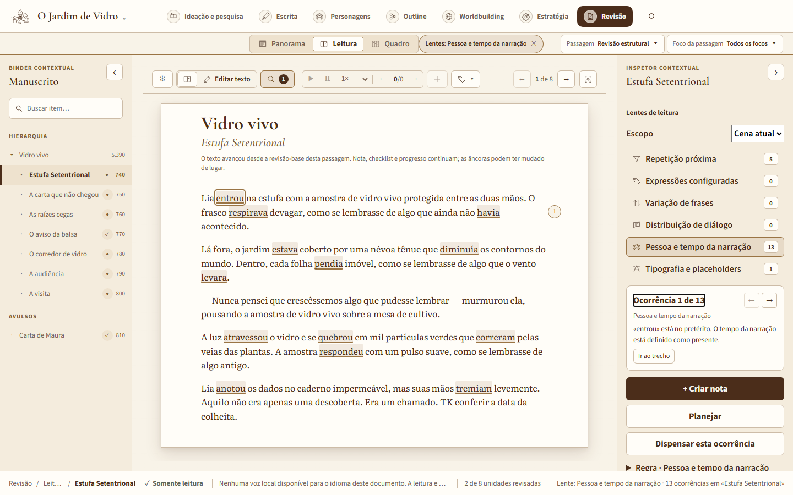
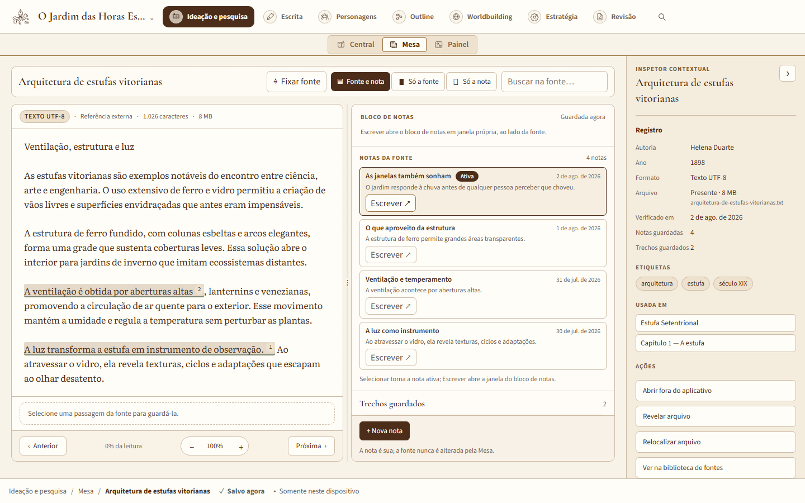
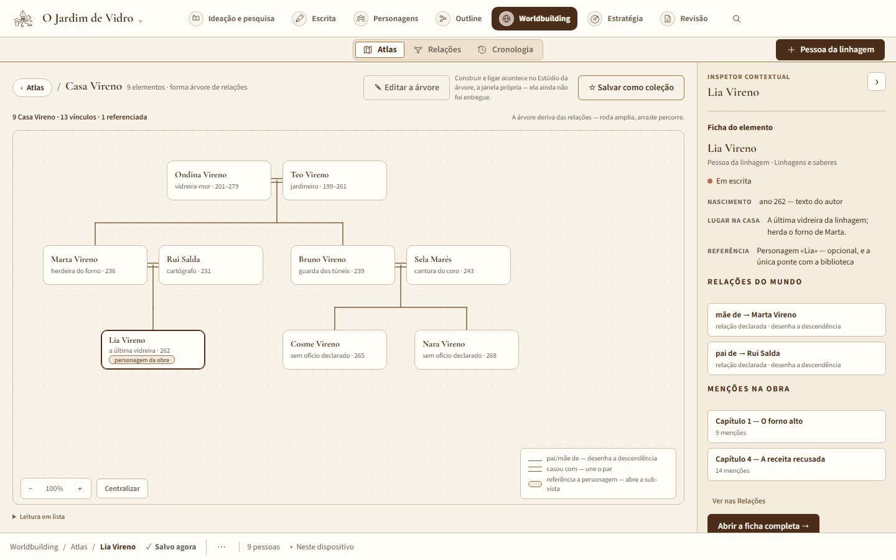
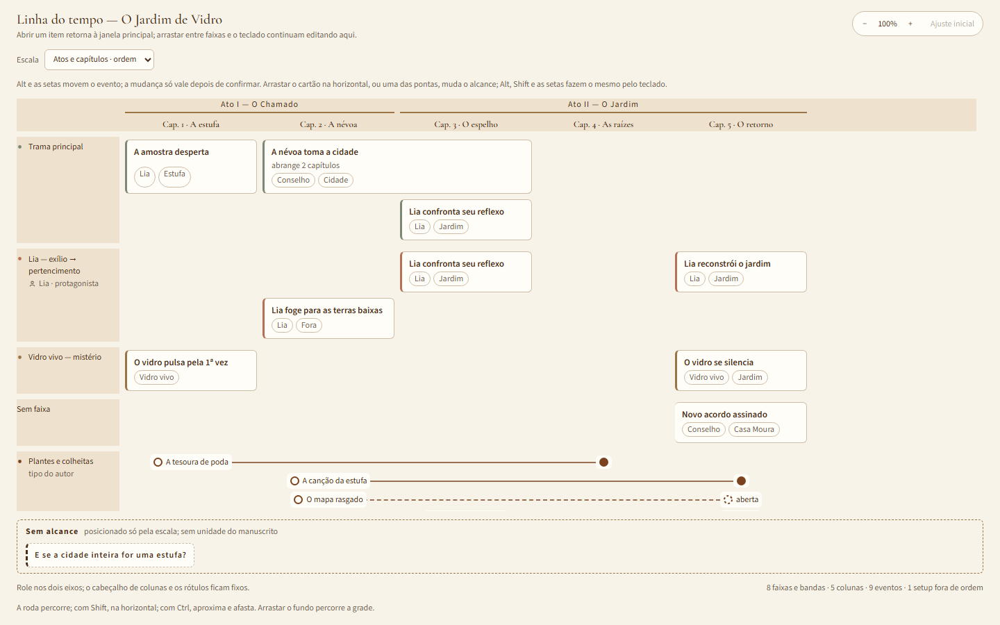
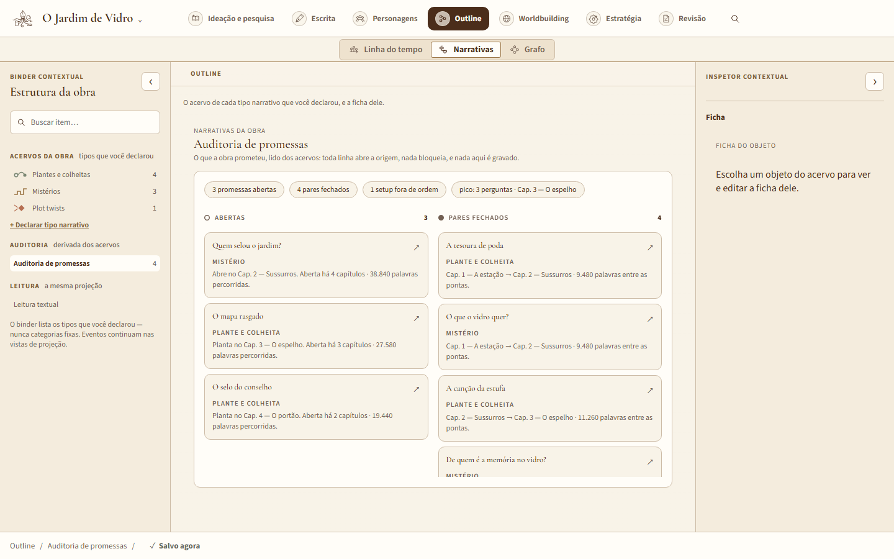
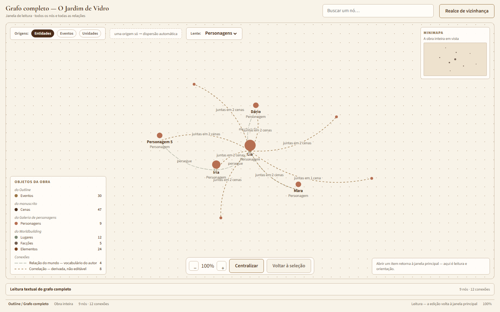
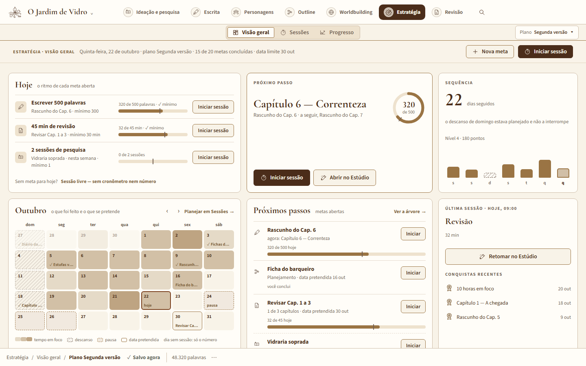
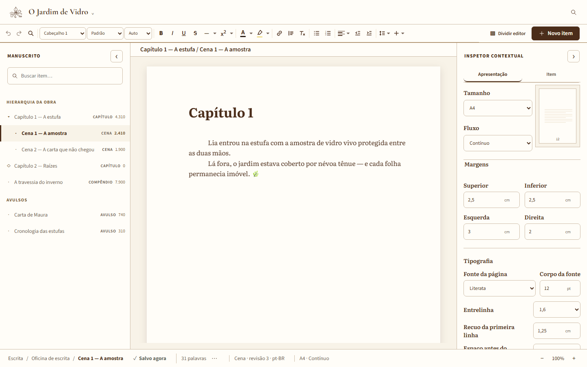
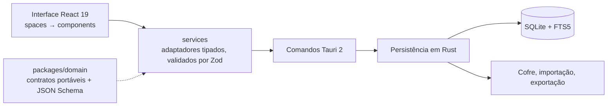

# Estudo de caso

[English](README.md) · **Português**

Uma plataforma desktop de escrita local-first para autores de textos longos:
pesquisa, worldbuilding, outline, escrita e revisão num só aplicativo, sem
impor método narrativo.

> O código-fonte é privado. Este repositório documenta o produto, a
> arquitetura, as decisões principais e como o trabalho é testado.

## O problema

Quem escreve romances e não ficção longa espalha o trabalho por várias
ferramentas — uma para notas, uma para o outline, uma para o mundo, uma para
o manuscrito. A maioria delas vive na nuvem ou impõe uma estrutura:
capítulos, cenas, uma ficha de personagem fixa, uma teoria "correta" de
história.

A plataforma toma a posição oposta:

- **local-first** — o computador do autor é a fonte de verdade; sem conta,
  sem servidor, funciona offline;
- **configurável, não prescritivo** — tipos de item, campos, vistas,
  vocabulário e capacidades narrativas são declarados pelo autor; não existe
  "capítulo" ou "arco" embutido;
- **o manuscrito é intocável** — toda gravação é transacional, versionada e
  recuperável, e os dados sempre podem sair do aplicativo em formato aberto.

## O que ele faz

| Espaço                 | O que o autor ganha                                                                                       |
| ---------------------- | --------------------------------------------------------------------------------------------------------- |
| Escrita                | Editor rico (Tiptap/ProseMirror), edição lado a lado, modos de página do contínuo ao livro aberto         |
| Pesquisa               | Fontes, cadernos, notas, citações e anotações, com promoção explícita ao manuscrito                       |
| Atlas (worldbuilding)  | Tipos de elemento criados pelo autor, relações tipadas, cânone e evidências, calendários, cronologia      |
| Outline                | Linha do tempo, narrativas e grafo sobre os mesmos identificadores; auditoria de promessas; apresentação  |
| Personagens            | Biblioteca de entidades e fichas configuráveis, compartilhadas entre a obra e o mundo                     |
| Revisão                | Lentes de leitura determinísticas (por exemplo, pessoa e tempo da narração) que explicam o que apontam    |
| Prática                | Sessões de escrita, metas e gamificação, tudo configurável e cada peça desligável                         |

Em tudo: busca de texto completo (SQLite FTS5), revisões e pontos de
restauração, lixeira que devolve o item ao lugar de onde saiu, desfazer
estrutural, exportação e importação com hashes de integridade, e idiomas
independentes para interface, obra, documento e trecho (português e inglês
hoje).

## Capturas

Capturadas do laboratório de componentes do projeto (Storybook), com uma
obra fictícia de exemplo. A versão em inglês mostra a mesma obra com a
interface em inglês: o idioma da interface e o da obra são independentes.

**Pesquisa — a Mesa de estudo.** A fonte lida ao lado das suas notas; a nota
é do autor, e a fonte nunca é alterada.

**Atlas — uma árvore de família.** Desenhada a partir das relações que o
autor declarou.

**Outline — a linha do tempo, em janela própria.** Eventos por atos e
capítulos, uma faixa por linha narrativa; plantes e colheitas correm como
fios que terminam respondidos ou ficam abertos.

**Outline — narrativas, pela auditoria de promessas.** Os acervos de todos
os tipos narrativos que o autor declarou, lidos juntos: o que a obra
prometeu, o que segue aberto e há quanto tempo, que pares fecharam e o que
está fora de ordem. Nada aqui bloqueia nem grava.

**Outline — o grafo completo, pela lente de personagens.** Uma janela de
leitura sobre todos os nós e relações; a lente fica com os personagens e o
que os liga — relações do mundo e correlações derivadas de cenas em comum.

**Prática — a visão geral.** As metas do dia, o próximo passo, uma sequência
que respeita o descanso planejado e o mês num relance.

**Escrita — a Oficina.** Tamanho da página, fluxo, margens e tipografia,
ajustados no inspetor.

## Arquitetura

Algumas regras mantêm as fronteiras no lugar:

- a interface nunca vê SQL nem caminhos do cofre; só a camada nativa toca o
  sistema de arquivos;
- o Rust não guarda teoria narrativa nem estado visual;
- o pacote de domínio não depende de nada — nem de React, nem de Tauri, nem
  do sistema operacional;
- uma única fonte de verdade por dado, mesmo com várias janelas abertas.

**Stack:** Tauri 2 · React 19 · TypeScript (strict) · Vite 7 · Tiptap 3 ·
Rust 1.97 · SQLite com FTS5 (bundled) · Zod 4 + JSON Schema · Vitest ·
Testing Library · Storybook 10 · pnpm workspaces.

## Decisões principais

Cada decisão está registrada num ADR (Architecture Decision Record), com
contexto, alternativas e consequências. Seis delas deram forma ao produto:

1. **Stack desktop local-first.** Tauri 2 e Rust como fronteira nativa
   estreita para arquivos, banco e credenciais; React para uma interface que
   cresce em várias vistas dos mesmos dados — sem transformar um protótipo
   pessoal num sistema distribuído.
2. **Formato aberto e persistência transacional.** O JSON do ProseMirror é o
   conteúdo canônico. Revisões são imutáveis; o autosave exige a revisão-base
   (concorrência otimista) e grava revisão, ponteiro e timestamps numa só
   transação, com WAL e `synchronous = FULL`. Toda restauração tira um
   snapshot antes e restaura _como revisão nova_, então o histórico nunca é
   apagado. As exportações são validadas por Zod e JSON Schema, levam
   Markdown legível e hashes SHA-256, e a pasta só é publicada quando todos
   os arquivos estão completos. O armazenamento do navegador foi rejeitado
   como fonte principal.
3. **Um cofre que o autor pode mover.** Mover o banco para outro disco usa a
   Online Backup API do SQLite, roda `PRAGMA integrity_check`, promove e
   reabre a cópia, grava uma configuração nova e imutável, e mantém a origem
   até uma segunda confirmação explícita. Se o cofre não estiver disponível
   na abertura, o aplicativo falha com mensagem clara — nunca abre um projeto
   vazio em silêncio.
4. **Várias janelas, uma sessão.** Quando cada espaço ganhou janela própria,
   o backend Rust passou a ser dono do estado de sessão, para que duas
   janelas não guardem cópias divergentes da mesma obra; gravação defasada é
   recusada pela revisão.
5. **Desfazer estrutural sem schema novo.** Mover ou arquivar um item é
   desfeito reaplicando o inverso pelos _mesmos_ comandos de domínio. Um
   inverso lido antes de a obra mudar por fora (outra janela, uma importação,
   uma restauração) é descartado em vez de aplicado sobre outra estrutura.
6. **Um léxico morfológico local.** Para apontar pessoa e tempo da narração
   de forma determinística, o aplicativo empacota os dicionários do
   LanguageTool (LGPL-2.1) nos dois idiomas, fixados num commit. Quando a
   forma é ambígua — "cantamos" é presente e pretérito —, a regra se cala em
   vez de adivinhar.

## Como a integridade dos dados é testada

Persistência é a área de maior risco, então os testes miram as formas pelas
quais um manuscrito poderia ser perdido, corrompido ou duplicado:

- **Cofres congelados.** O cofre que cada migration gravou fica guardado em
  texto e é migrado até a versão atual a cada execução da suíte, byte a byte.
- **Pacotes de exportação congelados.** Cada versão antiga do formato é
  reimportada, reexportada e validada pelo domínio a cada execução.
- **Importação hostil.** Hash adulterado, path traversal, duplicatas, extras
  e colisões são recusados.
- **Interrupção.** Falha artificial em qualquer ponto não deixa registro
  parcial nem órfão invisível.
- **O contrato IPC dos dois lados.** O JSON exato de cada comando fica
  guardado uma vez: o teste do service em TypeScript confere que a função
  real o produz, e um teste Rust confere que o comando o aceita. Isso pega
  divergências de renomeação do `serde` que um `invoke` simulado nunca vê.
- **Teste de mutação.** No aceite de cada fase, o `cargo-mutants` roda sobre
  os arquivos de persistência que a fase tocou, para medir se os testes
  realmente detectam código quebrado.

## Três documentos-mestre

A plataforma é conduzida com ideias da engenharia de sistemas. Tudo o que
define o projeto mora em três documentos, e cada um responde a uma pergunta:

- **`PRODUCT-EXPERIENCE.md` — o que o produto deve fazer.** Mais de 400
  requisitos, cada um uma linha de tabela autocontida: identificador
  estável, uma necessidade por linha, prioridade (P0–P2), estado no ciclo de
  vida — especificado, implementado, em validação, validado, adiado ou
  rejeitado — e método de verificação entre os quatro clássicos: teste,
  demonstração, inspeção ou análise.
- **`ROADMAP.md` — em que ordem, e quando está pronto.** Fases com escopo,
  estado e critério de saída, funcionando como portões: uma fase só fecha
  quando o aceite passa, e as features entram uma capacidade por vez, de
  ponta a ponta. É o único documento que sequencia o trabalho.
- **`ARCHITECTURE.md` — as fronteiras e as garantias.** Componentes e suas
  interfaces, quem é dono de cada dado, o formato aberto, as camadas de
  recuperação, a evidência que os testes precisam continuar dando, e a régua
  que toda dependência nova precisa passar: problema observado, alternativa
  mais simples considerada, custo de saída, impacto em privacidade e
  recuperação, e uma prova pequena e removível. Decisões duráveis viram ADRs.

Quatro regras mantêm os três coerentes:

- **Um dono por fato.** Uma mudança atualiza só o documento cujo contrato
  mudou; o backlog nunca é duplicado, e o histórico mora no Git, não nos
  documentos.
- **Rastreabilidade.** Os prompts de cada feature e os testes citam os
  requisitos pelo identificador — mais de 200 deles aparecem diretamente nos
  testes —, e as seções são citadas pelo nome, nunca pelo número, para que
  reorganizar um documento não desvie uma referência em silêncio.
- **Verificar não é validar.** Testes e gates provam que o software foi bem
  construído; um requisito só fica _validado_ depois que eu o exercito no
  uso real.
- **Divergência se declara, nunca se resolve em silêncio.** Quando código,
  requisito e documentação discordam, a diferença é nomeada e uma síntese,
  proposta.

## Prática de engenharia

- **Gates de qualidade.** Um gate rápido (typecheck, lint, formatação,
  testes, bundle) e um de persistência (`rustfmt`, `clippy -D warnings`,
  `cargo test`), os dois no CI em Windows, mais um job de portabilidade em
  Linux.
- **Revisão visual.** Storybook com dados fictícios e determinísticos; os
  testes de interação das stories rodam dentro da suíte, e um script mede
  cada story listada num navegador headless — nos dois idiomas, na janela
  mínima e em 1440×900 — e reprova rolagem horizontal ou texto cortado sem
  reticências.
- **Portabilidade por regra.** O alvo é o Windows, mas o código segue CSS
  compatível com WebKit, `Path::join` em vez de caminho montado em string, e
  chamadas ao sistema escritas para as três plataformas no mesmo commit.

### Feito com agentes de IA, num processo que eu desenhei

Construo a plataforma com agentes de IA de programação (Claude Code e Codex).
Meu trabalho é a parte que torna isso confiável: os requisitos e critérios
de aceite, a arquitetura e seus registros de decisão, o contrato dos agentes
que define papéis e fronteiras, os prompts de cada feature, os gates de
qualidade, e a revisão e o aceite de cada mudança. O fluxo usa papéis só de
leitura para exploração e revisão, e dois executores paralelos com escopo de
escrita exclusivo — interface e persistência em Rust — que só começam depois
que o contrato de domínio está fechado.

## Em números

Em outubro de 2026, com cerca de três meses de projeto:

- mais de 320 commits, versão 0.3.0 (candidata local)
- mais de 400 requisitos, cada um com prioridade, estado e método de verificação
- 46 migrations SQLite
- mais de 540 testes Rust e cerca de 3.900 casos de teste em TypeScript
- 77 arquivos de stories no Storybook
- 6 ADRs
- interface em português e inglês

## Estado e próximos passos

As Fases 0 a 8 estão implementadas — fundação, núcleo local, customização,
interface, pesquisa, worldbuilding, outline, revisão, e prática e metas —, a
maioria validada e o restante em validação pessoal. Estúdio de mapas,
leitura beta, sincronização e colaboração vêm depois. A IA assistiva é, de
propósito, a **última** fase, e só como proposta revisável: ela nunca altera
o texto do autor por conta própria.

---

Projetado e desenvolvido por Sávio Morais.
